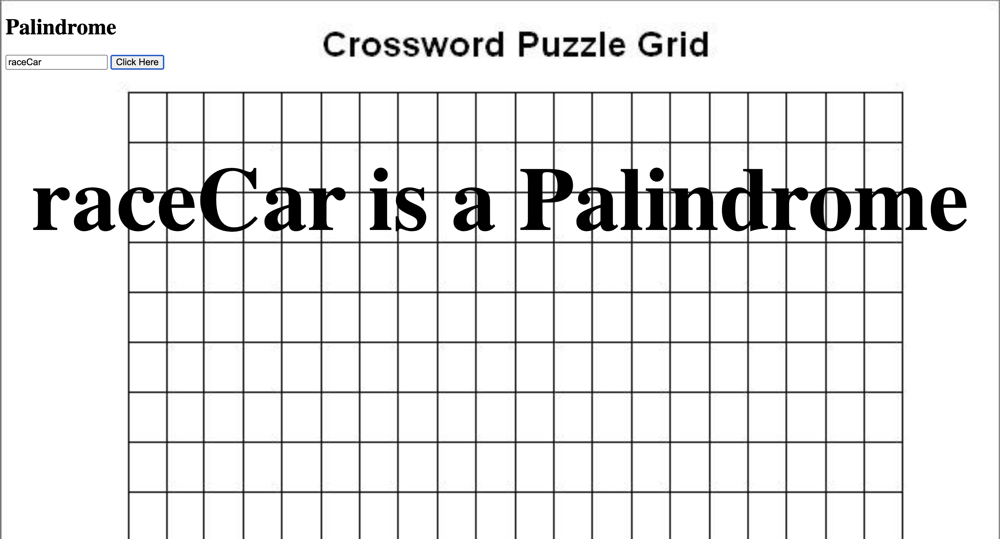

Palindrome Checker
Type in a word or phrase and find out if it's a palindrome.

What's a Palindrome?
A word or phrase that reads the same forwards and backwards, like racecar, level, or A man, a plan, a canal: Panama. This checker automatically ignores spaces, punctuation, and capital letters, so phrases like the last one count properly.

Features
Text Input Validation: Type any word, phrase, or sentence to check its palindrome status.

Smart Cleansing: Strips out spaces, punctuation, and case sensitivity automatically using regular expressions.

Client-Server Architecture: Sends your text to a Node.js server via an /api route, processes the logic, and returns the result in JSON format.

How It Works
You type something in and hit the button.

The front end sends your word to the server's /api route, the server checks it, and sends back the answer as JSON.

The server-side check happens in 3 steps:

Clean it up: A regular expression (/[^A-Z0-9]/ig) strips out everything that isn't a letter or number, then .toLowerCase() normalizes the case.

Flip it: .split('') breaks it into an array of letters, .reverse() flips the order, and .join('') stitches it back into a string.

Compare: If the cleaned-up string matches the reversed version, it's a palindrome.

Built With
Node.js

JavaScript

HTML

CSS

